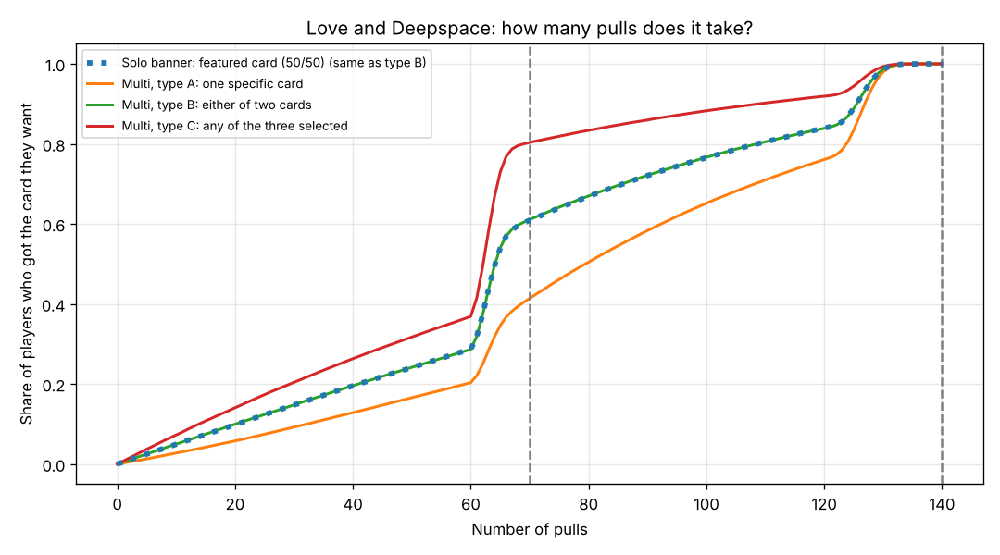
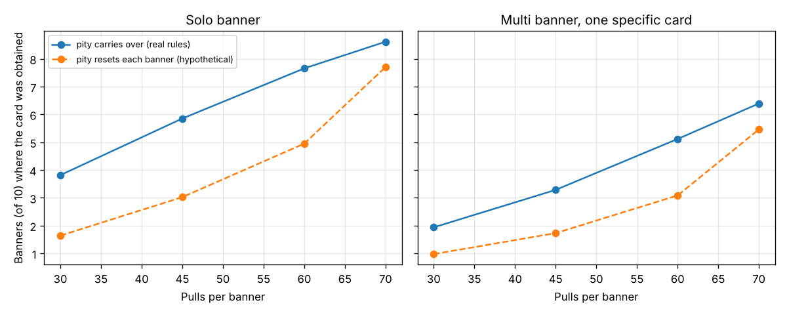

# Love and Deepspace: how many pulls do you really need?

A small Monte Carlo analysis of the gacha rules (pity system, 50/50, Precise Wish) in *Love and Deepspace*.

**Author: Daria Semenova**
**Tools: Python (random, NumPy, Matplotlib), Monte Carlo simulation**

## Question

"On average, a limited 5★ card costs about 70 pulls" says little about a real player's experience.
This project asks:

1. How many pulls and diamonds do different types of players need to get the card they want?
2. How much does the carry-over of the pity counter across banners matter, depending on how many pulls a player can afford per banner?

## Rules used

| Rule | Value | Source |
|---|---|---|
| 5★ rate | 1 % per pull up to pull 60 | third-party explainer (shattered.io), confirmed in-game by the author |
| Soft pity | from pull 61, +10 percentage points per pull | third-party explainer (shattered.io), confirmed in-game by the author |
| Hard pity | 100 % at pull 70 | third-party explainer (shattered.io), confirmed in-game by the author |
| Cost per pull | 150 diamonds | third-party explainer (shattered.io), confirmed in-game by the author |
| Pity counter | shared by all limited banners, carries over | official news post (Infold) and in-game check by the author |
| Solo banner | 50/50; after losing, the next 5★ is guaranteed to be the featured card; the guarantee carries over | in-game check by the author |
| Multi banner | 5 limited cards, 3 selected (25 % each), 1 chosen as Precise Wish; after a miss the next 5★ is guaranteed to be the target; the Precise Wish point does not carry over | in-game check by the author |

The official post confirms the structure of the system but gives no numbers. Rates above are not from an official table.

## Method

Each scenario is simulated 200,000 times with a Python Monte Carlo model (`random`, `numpy`).
Player types on a multi banner:

- **A** wants exactly one specific card (25 % on the first 5★),
- **B** is happy with either of two cards (50 %),
- **C** is happy with any of the three selected cards (75 %).

If the first 5★ is not acceptable, the next one is guaranteed to be.

The second part simulates a series of 10 banners. The player receives a fixed number of pulls per banner, pulls until the target card is obtained, and saves leftover pulls. "Carry over" uses the real rules; "reset" is a hypothetical case where the pity counter and the 50/50 guarantee disappear at the end of each banner.

## Results

### Pulls needed for one card 

| Scenario | Mean | Median | 90th pct | Done within 70 | Done within 100 |
|---|---|---|---|---|---|
| Solo (50/50) | 70.9 | 65 | 126 | 61 % | 77 % |
| Multi, type A (one card) | 82.6 | 80 | 127 | 41 % | 65 % |
| Multi, type B (either of two) | 70.9 | 65 | 126 | 61 % | 77 % |
| Multi, type C (any of three) | 59.1 | 63 | 109 | 80 % | 88 % |

At 150 diamonds per pull, the median is about 9,750 diamonds (solo) and about 12,000 (multi, type A). The 90th percentile is roughly 19,000.



### Series of 10 banners (average number of banners with the card obtained)

| Pulls per banner | Solo, carry-over | Solo, reset | Multi A, carry-over | Multi A, reset |
|---|---|---|---|---|
| 30 | 3.8 | 1.6 | 2.0 | 1.0 |
| 45 | 5.9 | 3.0 | 3.3 | 1.8 |
| 60 | 7.7 | 5.0 | 5.1 | 3.1 |
| 70 | 8.6 | 7.7 | 6.4 | 5.4 |



## Findings

- The mean cost hides a wide spread: the 90th percentile is almost twice the median.
- A player who wants one specific card on a multi banner needs noticeably more pulls than one who accepts any of the three selected cards.
- Carrying the pity counter over between banners roughly doubles the result for players who pull 30–45 times per banner.
- With the stated Precise Wish rule (the point does not carry over), a low-budget player on a multi banner does worse than on a solo banner.

## Limitations

- Rates come from a third-party source and the author's in-game checks, not an official table.
- The player model is simple: one target per banner, pulls until the target is obtained, leftover pulls are saved.
- Other banner types (e.g. standard banners), pull discounts and event bonuses are not modelled.

## Run

```
pip install numpy matplotlib
python gacha_model.py      # single-banner analysis, writes satisfaction.png
python sequence_model.py   # banner series, writes sequence.png
```
